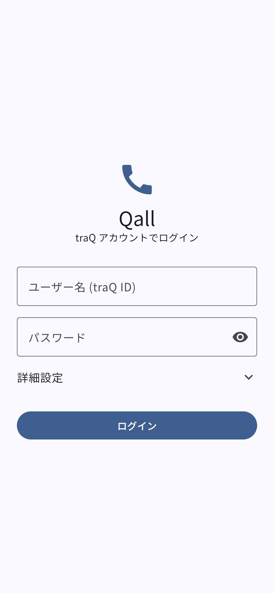
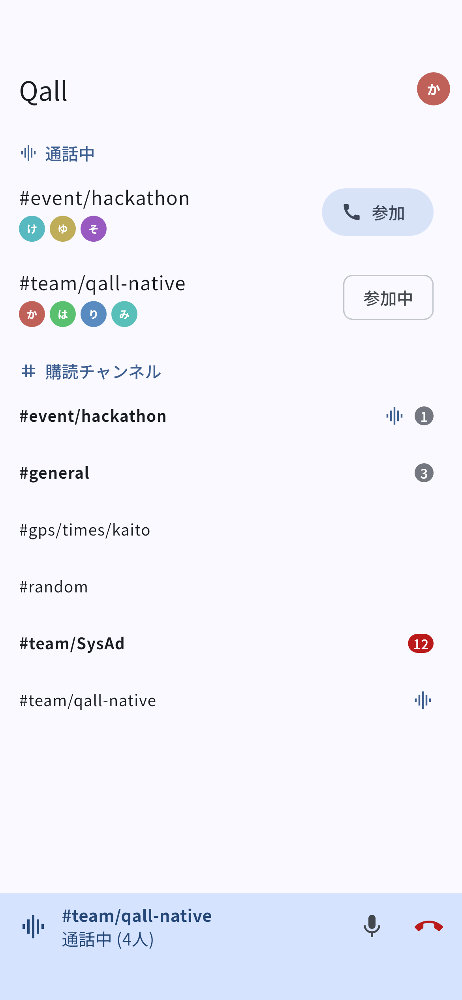
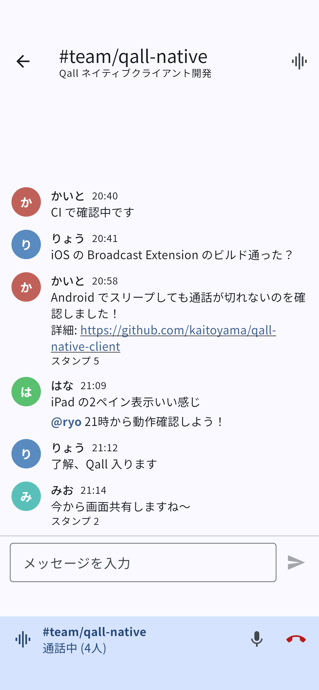
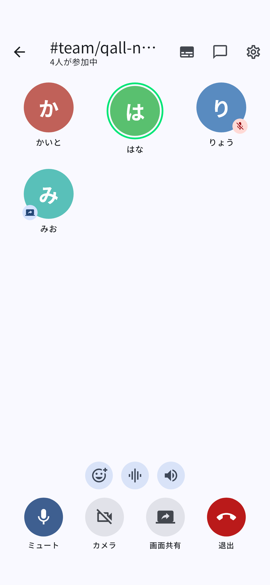
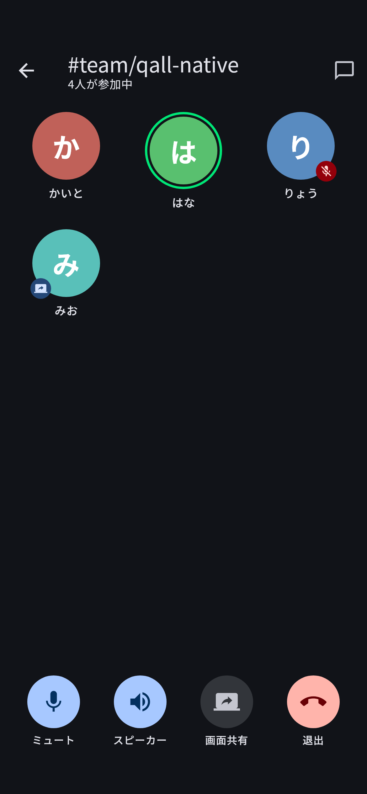
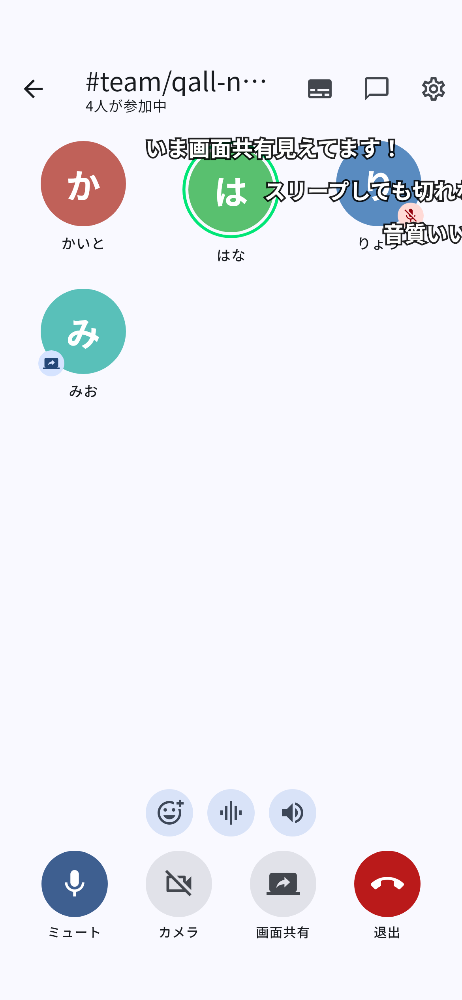
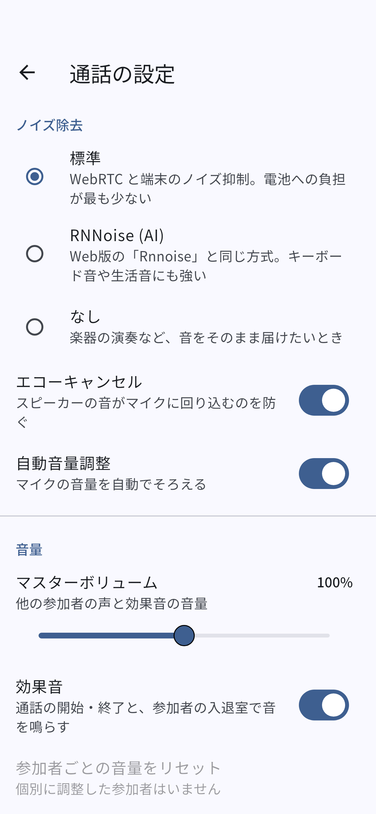
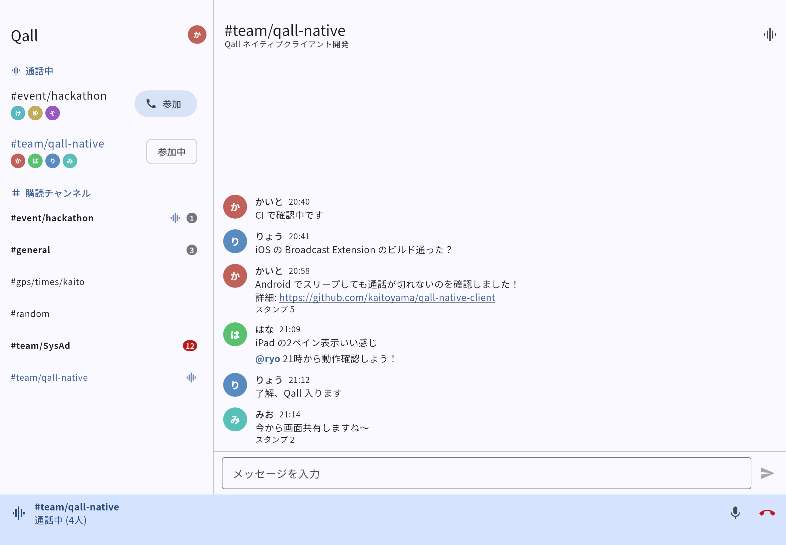

# Qall Native Client

> [!NOTE]
> [kaitoyama](https://github.com/kaitoyama) が個人で作っている**非公式のプロトタイプ**です。traP 公式のアプリではありません。

[traQ](https://github.com/traPtitech/traQ) の **Qall (通話)** を中心にした iPhone / iPad / Android 向けネイティブクライアントです。Flutter で1つのコードベースから両OSをビルドします。

メッセージ機能は最小限にとどめ、Qall は Web版 (traQ_S-UI) の機能・設定をひととおり取り込んでいます。

| 機能 | 内容 |
| --- | --- |
| 通話 | Qall ルームへの参加・退出、ウェビナーモードでの開始、ミュート、スピーカー/受話口 (Android は出力先も選択可)、参加者と発話中の表示 |
| バックグラウンド通話 | アプリを閉じても、画面がスリープしても通話が続く |
| 画面共有 | 端末の画面全体を共有 (Android: MediaProjection / iOS: Broadcast Upload Extension)、他の人の画面共有・カメラ映像の視聴 (ピンチで拡大可) |
| カメラ | カメラ映像の送信、前面/背面の切り替え |
| リアクション | スタンプでリアクション (最近使ったもの + 検索)、サウンドボード (再生・音の追加) |
| 弾幕 | 通話中のチャンネルへの投稿とスタンプを画面に流す (ON/OFF) |
| 音声 | ノイズ除去 (標準 / RNNoise / なし)、エコーキャンセル、自動音量調整、iOS のマイクモード (声を分離)、マスターボリューム、参加者ごとの音量、入退室の効果音、メッセージの読み上げ (声・ピッチ・速さ・音量) |
| チャンネル | 購読中のチャンネル一覧 (未読数つき)、全チャンネルの検索、アプリ内のお気に入り (チャンネルIDで保存するので、移動・改名しても外れない) |
| メッセージ | メッセージの閲覧・送信 (WebSocket でリアルタイム更新) |
| その他 | 通話中のルーム一覧、iPad / タブレットでは2ペイン表示 |

## スクリーンショット

ダミーデータで描画したものです (`tool/screenshots/` で生成)。

| ログイン | チャンネル一覧 | メッセージ | 通話 | 通話 (ダーク) |
| --- | --- | --- | --- | --- |
|  |  |  |  |  |

| 弾幕 | 通話の設定 |
| --- | --- |
|  |  |

iPad (横向き・2ペイン)



## 動かし方

```sh
flutter pub get
flutter run            # 接続中の実機 / シミュレータで起動
```

- Flutter 3.47 (stable) で開発しています
- ログインは traQ の OAuth2 です (下の「OAuth2 クライアント」を参照)。接続先とクライアントIDはログイン画面の「詳細設定」でも変更できます
- 通話・画面共有は実機で確認してください (シミュレータ / エミュレータではマイクや画面キャプチャが制限されます)

### OAuth2 クライアント

q.trap.jp 用のクライアント (ID `SVi9KL1akUgMRgEN0G9ItOgzngcrf6QAvM8B`) をアプリに埋め込んであります。別の traQ サーバーで使う場合や、自分のクライアントを使う場合は、traQ の Bot Console で次の内容で登録してください。

| 項目 | 値 |
| --- | --- |
| コールバックURL | `io.github.kaitoyama.qall:/oauth2/callback` |
| スコープ | `read` / `write` / `qall` |

Bot Console で作ったクライアントは公開クライアント (クライアントシークレットを使わない) になります。発行されたクライアントIDは、`--dart-define=TRAQ_CLIENT_ID=...` を付けてビルドするか、ログイン画面の「詳細設定」で指定します。公開クライアントなので、クライアントIDは公開してもかまいません。クライアントシークレットはアプリに入れないでください (アプリから取り出せてしまいます)。

コールバックURLのスキーム `io.github.kaitoyama.qall` は Bundle ID とは別に固定しています。Bundle ID を変えたビルドやフォークでも、同じクライアントをそのまま使えます。スキームを変える場合は、`lib/core/traq_oauth.dart` の `oauthRedirectScheme`、`android/app/src/main/AndroidManifest.xml` の `CallbackActivity`、traQ に登録したコールバックURL の3か所をそろえてください。

### iOS の初回セットアップ

`ios/Runner.xcworkspace` を Xcode で開き、以下を行ってください。

1. `Runner` と `BroadcastExtension` の両ターゲットで *Signing & Capabilities* の Team を設定する
2. 両ターゲットに App Group `group.io.github.kaitoyama.qall` が付いていることを確認する (自動署名なら Xcode が登録します)

Bundle ID を変える場合は、プロジェクト (PROJECT > Runner) のビルド設定で次の3つをそろえて変更してください。Info.plist と entitlements はここから展開されます。

| ビルド設定 | 既定値 |
| --- | --- |
| `PRODUCT_BUNDLE_IDENTIFIER` (Runner ターゲット) | `io.github.kaitoyama.qall` |
| `BROADCAST_EXTENSION_BUNDLE_IDENTIFIER` | `io.github.kaitoyama.qall.BroadcastExtension` |
| `APP_GROUP_IDENTIFIER` | `group.io.github.kaitoyama.qall` |

Android の applicationId は `android/app/build.gradle.kts` にあります。

## APK の配布

`v1.2.3` のようなタグを push すると、GitHub Actions (`.github/workflows/release.yml`) が署名済みの APK をビルドし、[Releases](https://github.com/kaitoyama/qall-native-client/releases) に置きます。

```sh
git tag v1.0.0
git push origin v1.0.0
```

署名鍵は、GitHub の `release` 環境の Secrets に入れておきます。この環境は `v*` タグからのデプロイだけを許可しているので、他のブランチのワークフローからは鍵を読めません。鍵が変わると上書きインストールできなくなるので、鍵ファイルとパスワードはなくさないよう保管してください。

| Secret (`release` 環境) | 内容 |
| --- | --- |
| `ANDROID_KEYSTORE_BASE64` | keystore (`.jks`) を base64 にしたもの |
| `ANDROID_KEYSTORE_PASSWORD` | keystore のパスワード |
| `ANDROID_KEY_PASSWORD` | 鍵のパスワード |

鍵のエイリアスは `qall` に固定しています (`release.yml`)。

手元で同じ鍵を使ってビルドする場合は、`android/key.properties` に `storeFile` / `storePassword` / `keyAlias` / `keyPassword` を書きます (git には入りません)。このファイルがなければデバッグ鍵で署名します。

## 設計メモ

### 認証: OAuth2 (認可コード + PKCE)

traQ の OAuth2 の認可コードフローでログインします (`lib/core/traq_oauth.dart`)。Qall API (`/api/v3/qall/*`) が要求する `WebRTC` 権限は `qall` スコープに含まれます (traQ#3430)。

- 認可画面は iOS では ASWebAuthenticationSession、Android では Custom Tabs で開きます ([flutter_web_auth_2](https://pub.dev/packages/flutter_web_auth_2))。ブラウザの traQ のログイン状態をそのまま使えるので、外部ログインのアカウントでも入れます
- リダイレクト先には、リバースドメイン形式のカスタムスキーム `io.github.kaitoyama.qall:/oauth2/callback` を使います ([RFC 8252](https://www.rfc-editor.org/rfc/rfc8252) 7.1)
  - カスタムスキームは他のアプリも登録できます。そのため、認可コードを横取りされても使えないよう、PKCE (S256) を必ず使います。traQ も http(s) 以外のリダイレクト先では PKCE を必須にしています
  - Universal Links / App Links (https のリダイレクト先) は、アプリの署名とドメインを結び付ける必要があります。誰でもビルドできるコミュニティのアプリには向かないので、使っていません
- アクセストークンは Keychain / Android Keystore (`flutter_secure_storage`) に保存し、API・WebSocket・画像の取得に `Authorization: Bearer` で付けます
- traQ の既定の設定ではリフレッシュトークンが発行されず、アクセストークンは1年間有効です。期限が切れて 401 が返ったら、ログイン画面に戻します
- ログアウト時は `POST /api/v3/oauth2/revoke` でトークンを無効にします

### Qall (LiveKit) と Web 版との互換性

traQ の Qall は [LiveKit](https://livekit.io) で動いています。traQ_S-UI (Web版) と同じルールで接続するので、Web版の参加者と同じ通話に入れます。

- ルーム名 = チャンネルID。`GET /qall/endpoints` で LiveKit の URL、`GET /qall/token?roomId=` でトークンを取得
- 参加者の identity は `{traQユーザーID}_{ランダムUUID}`。末尾37文字を落としてユーザーIDを得ます
- **マイクのトラックは必ず publish します**。Web版の参加者一覧はマイクトラックの有無で表示を決めているため、ミュート中も (無音の) トラックは出し続けます
- ルームの参加者一覧は `GET /qall/rooms` と WebSocket の `QALL_ROOM_STATE_CHANGED` で更新
- スタンプリアクションは data メッセージ `{"type":"stamp","message":"<stampId>"}`

### スリープしても通話を続ける仕組み

| | 仕組み |
| --- | --- |
| Android | 通話中は `microphone` タイプのフォアグラウンドサービス (`flutter_foreground_task`) を起動し、WakeLock / WifiLock を保持。通知に「ミュート」「退出」ボタン。画面共有中は `mediaProjection` タイプも付与 |
| iOS | `UIBackgroundModes` に `audio` / `voip`。ミュート中もマイクのキャプチャを止めない (`stopAudioCaptureOnMute: false`) ことで音声セッションを動かし続け、OS にサスペンドされないようにしています |

Android でバッテリー最適化が強い端末 (一部の国内メーカー端末など) では、設定からこのアプリを「最適化しない」にすると安定します。

### 画面共有

- **Android**: `Helper.requestCapturePermission()` で許可を得てから、`mediaProjection` タイプのフォアグラウンドサービスを開始し、LiveKit で publish します (Android 14 以降はこの順番が必須)
- **iOS**: `ios/BroadcastExtension` の Broadcast Upload Extension が ReplayKit で画面を取得し、App Group 内の UNIX ソケット経由で本体アプリへ渡します。共有ボタンを押すとシステムの「画面収録」ピッカーが出ます。コントロールセンターから止めても連動します
- いずれも端末の音声 (アプリの音) は共有しません

### ノイズ除去

設定の「ノイズ除去」で3つから選べます (Web版の Rnnoise / Speex / 無効 に相当)。

| 方式 | 中身 |
| --- | --- |
| 標準 (既定) | WebRTC のノイズ抑制 + 端末のハードウェア処理。iOS ではさらにユーザーが「マイクモード → 声を分離」を選べる (アプリからは変更できず、設定画面からシステムの画面を開ける) |
| RNNoise | [RNNoise](https://gitlab.xiph.org/xiph/rnnoise) (v0.1.1, BSD-3-Clause) をソースからビルドして組み込み。二重にかからないよう WebRTC 標準のノイズ抑制は切る |
| なし | 処理なし (エコーキャンセルと自動音量調整は個別に ON/OFF) |

RNNoise は `packages/qall_audio` (アプリ内のプラグイン) で動かしています。

- Android: flutter_webrtc の録音スレッド (`WebRtcAudioRecord`) が WebRTC に PCM を渡す直前の `AudioBufferCallback` にリフレクションで差し込む (WebRTC の帯域分割前の全帯域で処理するため)
- iOS: flutter_webrtc の `AudioManager.capturePostProcessingAdapter` に登録する

参考: Discord は Krisp (商用 SDK)、Teams・Google Meet・LINE は自社の機械学習モデルを使っている。LiveKit 公式の Krisp フィルタ (`livekit_noise_filter`) は LiveKit Cloud 専用で、traQ のような自前ホストの LiveKit では使えない。

### 読み上げ・効果音

読み上げ (Android: TextToSpeech / iOS: AVSpeechSynthesizer) と効果音の再生も `qall_audio` に実装しています。通話中の音声経路 (スピーカー / 受話口 / イヤホン) を乱さないよう、Android は `USAGE_VOICE_COMMUNICATION` で鳴らし、iOS はアプリの音声セッションをそのまま使います。読み上げる文の作り方は Web版 (`lib/tts/format.ts`) に合わせています。効果音は traQ_S-UI のもの (MIT License, `assets/se/NOTICE`) です。

### 依存関係のメモ

- サウンドボードへの音の追加は、API 定義 (`audio` / `soundName`) と traQ サーバーの実装 (`file` / `name`) でフィールド名が食い違っているため、両方の名前で送っています

- `permission_handler` は `^12` に固定しています。13 系 (permission_handler_android 14) は compileSdk 37 を要求し、Flutter テンプレートの AGP 9.1 では `android-37` を解決できないためです。Flutter のテンプレートが追いついたら上げてください
- iOS の画面共有の停止に使う `BroadcastManager` は livekit_client の公開APIから export されていないため、`package:livekit_client/src/...` を直接 import しています。livekit_client を上げるときはこの import が壊れていないか確認してください

## ディレクトリ構成

```
lib/
  core/                 traQ API / WebSocket / 認証 / モデル
  features/
    auth/               ログイン画面
    home/               トップ (スマホ: 1ペイン、iPad: 2ペイン)
    channels/           購読チャンネル一覧・通話中ルーム一覧
    messages/           メッセージ一覧・送信
    qall/               通話 (LiveKit 制御、バックグラウンド維持、通話画面、弾幕、スタンプ、サウンドボード)
  settings/           通話の設定
ios/BroadcastExtension/ iOS の画面共有用 Extension
packages/qall_audio/    RNNoise・読み上げ・効果音・iOS マイクモードのネイティブ実装
```

## テスト / CI

```sh
flutter analyze
flutter test
```

GitHub Actions (`.github/workflows/ci.yml`) で analyze・test・Android の debug APK・iOS (署名なし) のビルドを行います。

スクリーンショットの更新 (Noto Sans JP の Regular / Medium / Bold の `.ttf` を置いたディレクトリを指定):

```sh
QALL_SCREENSHOT_FONT_DIR=/path/to/fonts flutter test tool/screenshots
```

## 今後やりたいこと

- カメラの背景ぼかし・背景画像 (Web版にはある。端末ごとに人物の切り抜き処理をネイティブで実装する必要がある)
- 画面共有で端末の音も流す (flutter_webrtc がモバイルで未対応)
- 通話への招待・着信通知 (CallKit / FCM)
- メッセージの Markdown 表示・スタンプ表示
